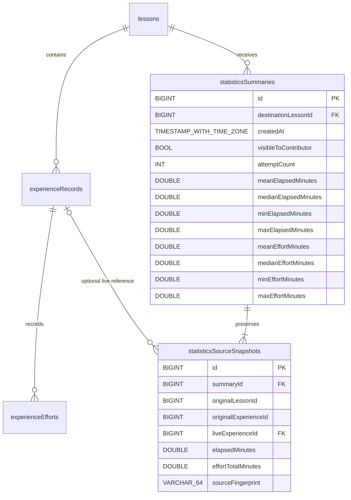

# TP3 persistent statistics and visibility

This document records the statistics increment. The next increment adds the real AI adapter
and review workflows; see [TP3_AI.md](TP3_AI.md), including its pending live-provider verification.

This increment continues on `tp3` from `b7e72f90f408351118089977669b25e9c31f89ed`.
The original `hw3` baseline remains `bec1de6bdafad9a8962586ec02205203e96c1920`.

## Implemented user stories

| Required behavior from the derived Staff User Stories | Working implementation | Verification |
| --- | --- | --- |
| Select at least two distinct experience attempts, including across lessons | Curator Statistics source browser, multiple selection, fixed destination lesson | `previewAndSave`, `invalidSelections`, `collectionSizes`, GUI selection checks |
| Count, mean, median, minimum, maximum elapsed minutes and per-attempt effort person-minutes | Pure `StatisticsCalculator`, validated source capture | `calculationBoundaries`, `invalidNumbers`, `invalidStoredSources` |
| Review before saving | Immutable `StatisticsPreview` and `StatisticsRequest` fingerprints; changed selections invalidate GUI review | `stalePreview`, `deletedPreviewSource`, `invalidReviewedRequests`, GUI stale-preview checks |
| Persistent traceable snapshot | Hidden summary header plus all source snapshots in one existing H2 transaction | `previewAndSave`, `rollback`, `enclosingRollback`, `persistenceAcrossProcesses` |
| Historical results survive source changes/deletion | Original IDs and captured numeric inputs retained; nullable live link; advisory staleness comparison | `sourceChanges`, `fingerprintCoversOrderedEfforts`, `explicitRecalculation` |
| Explicit Contributor visibility | Curator Share Summary / Hide Summary; saved hidden default; owned aggregate-only query | `visibilityAndPrivacy`, `permissions`, `revokedRoles`, GUI visibility checks |
| Preserve inherited protections and persistence | Same current-role checks, sorted parent locks and transaction wrapper | `concurrentInputs`, `protectedSourcesRemainReviewable`, `migration`, all inherited suites |

`StatisticsService` coordinates these rules separately from the already implemented Curator
core editing service. It uses the existing shared `Database` and `OperationResult`; no new
framework or application connection is introduced. GUI packages follow View/Controller/Model
families. Contributor and Viewer lesson access paths remain intact.

## Calculation and review rules

- One distinct `ExperienceRecord` is one attempt. Duplicate selected IDs count once. Require
  at least two valid attempts; there is no fixed selection ceiling. A selection may span lessons.
- Validate every selected source. Missing records, invalid IDs, negative/non-finite elapsed or
  effort, missing member names, empty effort lists, and an unrepresentable effort total reject
  the whole operation. Invalid sources are never silently dropped.
- Sum member effort for each attempt in person-minutes, then calculate statistics across those
  per-attempt totals. Keep effort separate from elapsed minutes.
- Sort copies for medians/minimum/maximum. Decimal accumulation and midpoint calculations avoid
  overflowing intermediate sums when a final finite mean/median is representable. Full double
  values are stored. Zero is valid under inherited validation.
- Preview writes nothing. The request contains destination, selected IDs and reviewed SHA-256
  fingerprints, never trusted client-side calculation results. The fingerprint covers parent ID,
  experience ID, elapsed double, and the ordered member names/effort doubles using length prefixes.
- Save reauthorizes the current Curator, locks destination/source parent lessons in ascending ID
  order, reloads sources, validates, compares fingerprints, recalculates and inserts all rows.
  Changed or missing inputs reject the save and require Preview Statistics and renewed review.
- Every new snapshot starts hidden. Only explicit Share Summary / Hide Summary changes visibility.
  Sharing does not change calculations, creation time or source evidence.
- Saved values are historical and never silently recalculated. Curator reads compare with current
  live inputs to show an advisory earlier-data notice. Explicit recalculation saves a new snapshot.

For invented course attempts of 30 and 50 minutes with effort totals of 40 and 80 person-minutes,
count is 2; elapsed mean/median is 40, min 30, max 50; effort mean/median is 60, min 40, max 80.
These examples are invented and are not claimed to come from Ed Discussion.

## Data model and migration

Additive `CREATE TABLE IF NOT EXISTS` statements preserve existing account, lesson, term,
experience and effort data. Existing Contributor protection flags are unchanged.



A saved summary has **at least two** distinct child attempts. The unique pair is
`(summaryId, originalExperienceId)`. Deleting a destination cascades its summaries and children.
Deleting a live source sets `liveExperienceId` to null while preserving original identifiers and
captured inputs. Original source IDs intentionally have no foreign key. UTC-offset timestamps
retain the creation instant when reopening in another time zone.

Contributor `SharedStatistics` contains only summary ID, creation instant and `StatisticsValues`.
No source IDs, foreign member names, raw attempts, fingerprints or hidden rows enter that query's
returned data. Only a currently assigned Contributor who owns the destination may read it.
Curator-only list/read/mutation methods independently require current Curator assignment;
Admin and Viewer do not implicitly receive those permissions. Lessons may remain protected
against Contributor mutations while Curators review or save statistics.

## Files and documented interfaces

- `entityClasses/StatisticsValues`, `StatisticsSourceSnapshot`, `StatisticsRequest`,
  `StatisticsPreview`, `StatisticsSummary`, `SharedStatistics`: immutable data and defensive copies.
- `lessonManagement/StatisticsCalculator`: pure validated calculation.
- `lessonManagement/StatisticsService`: `listSources`, `preview`, `save`, `listSummaries`,
  `readSummary`, `setVisibility`, `sharedSummaries` with current role/ownership enforcement.
- `database/Database`: additive schema; `insertStatisticsSummary`, `getStatisticsSummary`,
  `getStatisticsSummaries`, `getSharedStatistics`, `updateSummaryVisibility`; protected child
  insert permits realistic post-write storage-failure testing. These low-level methods serve
  trusted authorized service workflows and do not commit an enclosing transaction.
- `guiCuratorStatistics/`: preview/save/history/share/hide MVC. Curator Review gains
  Statistics and Visibility for the selected destination.
- `guiContributorStatistics/`: safe read-only aggregate MVC. Contributor lesson details gains
  Shared Statistics and return navigation.
- `test/database/TP3StatisticsTest`, `TP3StatisticsPersistenceProcess`,
  `test/guiTools/TP3StatisticsGuiTestingAutomation`: new service/persistence/JavaFX verification.
- Existing test and Javadoc scripts include all new production and testing code.

`module-info.java` is unchanged. JUnit and the headless backend remain test-only dependencies.
Default application database is still `jdbc:h2:~/FoundationDatabase`; automated tests use only
isolated file-backed paths and isolated GUI homes.

## Launch, automated verification and Javadoc

In Eclipse, refresh `tp3` and run the existing `applicationMain.TP2` Java Application with the
configured JDK 25, JavaFX and H2 libraries. The launcher retains its existing name.

Portable verification commands, using paths for your platform:

```bash
export TP3_JDK=/path/to/jdk-25
export TP3_JAVAFX_LIB=/path/to/javafx/lib
export TP3_H2_JAR=/path/to/h2.jar
export TP3_JUNIT_JAR=/path/to/junit-platform-console-standalone.jar
# Optional only when no desktop display is available:
export TP3_MONOCLE_JAR=/path/to/openjfx-monocle.jar
bash scripts/test_tp3_foundations.sh
export TP3_TEST_CLASSES=/path/to/test-output/classes
bash scripts/generate_tp3_javadocs.sh /path/to/new-javadoc-output
```

The runner compiles the modular production application and isolated classpath tests, executes
all nine inherited suites, all three JUnit classes, and all three real JavaFX automation suites.
A failure exits nonzero. Each run uses a new output directory and retains individual logs and
JUnit XML. Generated documentation folders are `New Code Javadoc` and `Test Code Javadoc`.

## Executed results — November 19, 2026

OpenJDK 25.0.1, JavaFX 25.0.1 Linux, H2 2.3.232, JUnit Platform 1.11.4, and
Monocle 21.0.2 were used. All tests below executed; none were skipped.

| Suite | Passed | Failed |
| --- | ---: | ---: |
| One-time password database | 18 | 0 |
| Delete-user database | 20 | 0 |
| List-users database | 13 | 0 |
| Add/remove roles database | 15 | 0 |
| Add/remove roles controller | 7 | 0 |
| HW2 CRUD/validation/persistence | 26 cases / 598 checks | 0 |
| TP2 boundaries | 12 cases / 204 checks | 0 |
| HW3 experience lock policy | 12 cases / 65 checks | 0 |
| Password evaluator | 11 | 0 |
| Foundation JUnit | 20 | 0 |
| Discovery/Curator JUnit | 22 | 0 |
| Statistics/visibility JUnit | 25 | 0 |
| Actual JavaFX role navigation | 22 | 0 |
| Actual JavaFX discovery/Curator operations | 42 | 0 |
| Actual JavaFX statistics/visibility | 36 | 0 |

Totals: 951 inherited checks, 67 JUnit scenarios, and 100 JavaFX checks, zero failures.
Modular and classpath compilation both succeeded. Production and test Javadoc generation
succeeded with `-Xdoclint:all,-missing`. The inherited FoundationsF26 module-name warning
remains; headless classpath JavaFX also reports its unnamed-module environment warning.
Native macOS visual/manual verification remains outstanding as described below.

Exact final verification commands executed from `/workspace/scratch/c73983b04b44`:

```bash
export TP3_JDK=/workspace/scratch/c73983b04b44/tools/jdk-25.0.1
export TP3_JAVAFX_LIB=/workspace/scratch/c73983b04b44/tools/javafx
export TP3_H2_JAR=/workspace/scratch/c73983b04b44/tools/lib/h2.jar
export TP3_JUNIT_JAR=/workspace/scratch/c73983b04b44/tools/lib/junit-console.jar
export TP3_MONOCLE_JAR=/workspace/scratch/c73983b04b44/tools/lib/monocle.jar
export TP3_TEST_OUTPUT=/workspace/scratch/c73983b04b44/statistics-final
bash repo/scripts/test_tp3_foundations.sh
export TP3_TEST_CLASSES=/workspace/scratch/c73983b04b44/statistics-final/classes
bash repo/scripts/generate_tp3_javadocs.sh /workspace/scratch/c73983b04b44/statistics-javadoc-final
```

The eight statistics persistence phases run in distinct JVMs, alternating creation in UTC
and verification in Pacific/Honolulu to verify timestamp portability. They cover creation,
reopen/shared values, source deletion, historical reopen, hiding, hidden reopen, destination
deletion, and cascading-deletion reopen. Tests also exercise partial child-write rollback,
visibility rollback, enclosing transactions, concurrent source edits, numeric boundaries,
large selections, missing data, role revocation, and owner-only aggregate projection.

## Eclipse manual checks still required

Headless automation exercises real JavaFX actions but does not prove native macOS rendering,
keyboard multiple selection, focus or readable scrolling. These manual steps remain unclaimed.
Use a dedicated home such as `/Users/yourname/cse360-tp3-manual-test` in Eclipse Run
Configurations > Arguments > VM arguments: `-Duser.home=/Users/yourname/cse360-tp3-manual-test`.
Keep the path identical across restarts. Create the directory before launch.

1. Refresh the project and run `applicationMain.TP2`. Create Admin, two separate Contributors,
   and a Curator through existing invitation/role controls. Retain the TP1 account safeguards.
2. As the first Contributor, create `H2 Persistence` and an experience with elapsed `30`, member
   `Sam` effort `40`. As the second Contributor, create `JavaFX Validation` and an experience
   with elapsed `50`, member `Alex` effort `80`. Supply nonblank what/how/core descriptions.
3. As Curator > Review Lessons, select `H2 Persistence` as destination > Statistics and Visibility.
   Expect source rows showing both lesson/experience IDs, elapsed minutes and member person-minutes.
   Check source scrolling and native Ctrl/Cmd/Shift multiple selection.
4. Select zero or one attempt > Preview Statistics. Expect corrective feedback and no saved row.
   Select both attempts > Preview Statistics. Expect the worked-example values above and both
   source IDs. Save must remain disabled until a valid preview. Changing selection must clear it.
5. Save Reviewed Snapshot. Expect one saved summary labeled Hidden, a creation instant, the same
   values and provenance. In the destination owner's lesson details > Shared Statistics, expect
   no shared values yet. Another Contributor must not read this destination's shared aggregates.
6. As Curator, select the saved summary > Share Summary. Refresh the owner's Shared Statistics.
   Expect only aggregate values and units, without member names, source IDs or raw attempts.
   Hide Summary and refresh again; expect those aggregates to disappear.
7. Preview again as Curator. Before saving, edit a source experience as its Contributor in another
   execution/session, then Save Reviewed Snapshot. Expect a changed-input error and no new saved
   row. Preview again, review and save; expect a new snapshot with the new calculations.
8. Refresh the older saved summary. Expect an earlier-data notice with its original values.
   Delete a foreign source lesson as its owner and refresh; original IDs and captured values must
   remain available to the Curator with a stale-data notice.
9. Share a snapshot and restart using the same home. Expect saved values, evidence, timestamp and
   sharing to persist. Hide it and restart; it must stay hidden. Delete the destination as its
   Contributor when protections permit; after restart its summaries must be absent.
10. Recheck Viewer discovery, Curator core edits/terms/protections, Contributor-only lists and
    experience CRUD, plus TP1 login, OTP replacement and self-protection controls.

## Remaining project scope

This increment fulfills persistent statistics and visibility under the derived staff stories.
Actual AI assistance remains later work. It does not add external LessonShare integration or
Curator deletion tools. Final DOCX/PDF design and submission-artifact alignment remain a separate
finalization pass. The assignment's discussion-assessment wording still needs instructor
clarification against the linked Lessons Learned epics; no unrelated discussion system is added.
