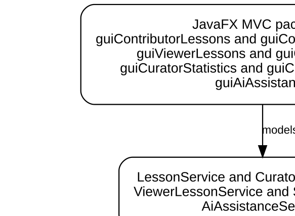

# Architecture

CSE 360 Team Project Phase 3. This outline documents the implemented Lessons Learned system on tp3, building on the hw3 baseline. The application preserves Foundations JavaFX MVC, file-backed H2, entities and existing testing conventions. Automated evidence is recorded separately from live-provider and native Eclipse checks that remain pending.

## 1 Scope and quality goals

- Preserve TP1 accounts, invitations, login, one-time password replacement, role administration, self-protection and account persistence.
- Preserve TP2 Contributor-only lesson lists, core and experience CRUD, validation, ownership, protected fields, relationship integrity and persistent deletion.
- Implement Viewer discovery; Curator review, terms, refinement and locks; historical statistics and sharing; and interactive AI assistance.
- Prioritize correctness, clear corrective feedback, private Contributor data, persistence across executions and simple maintenance by another course team.

## 2 Logical architecture

- Views build JavaFX controls. Controllers translate actions and navigate. Models connect page workflows to shared services. Business permissions are enforced beneath the GUI.
- LessonService retains Contributor operations through LessonsLearned, LessonsLearnedList and experience validation/policy. CuratorLessonService provides cross-owner review and authorized core/term/lock operations.
- ViewerLessonService returns ViewerLesson projections containing only ID and core text. It exposes no mutation methods or raw experience evidence.
- StatisticsService coordinates source review, preview, immutable snapshot save, staleness checks and explicit sharing. StatisticsCalculator is pure and has no JDBC or JavaFX dependency.
- AiAssistanceService authorizes and bounds context on the application thread, delegates only generation to AiClient on a worker, and saves reviewed text through existing services.
- RoleAccessService reads current persisted assignments. An old User snapshot never substitutes for a current permission decision.

## 3 Data and persistence view

- The default URL remains jdbc:h2:~/FoundationDatabase. Database owns the shared connection, table creation, role lookup, transaction wrapper and prepared statements.
- Existing userDB, InvitationCodes, lessons, experienceRecords and experienceEfforts remain. Curator assignment is additive; legacy Role1 means Contributor and Role2 means Viewer.
- lessonSearchTerms has primary key (lessonId, term) and cascading parent deletion. Normalized complete-set replacement is atomic.
- statisticsSummaries belongs to one destination lesson. statisticsSourceSnapshots retains original identifiers and captured elapsed/effort inputs, with a nullable live experience link. A deleted source never silently erases historical evidence.
- Creation timestamps use TIMESTAMP WITH TIME ZONE. Independent process tests reopen in a different time zone.
- AI conversations are in-memory workflow state. Only explicitly reviewed core and terms use existing persistent tables. There is no additional AI table.

## 4 Execution and consistency view

- Normal GUI and JDBC work stays on the JavaFX application path. Database.inTransaction uses one root transaction or a nested savepoint. A failure result or exception rolls back before feedback is returned.
- Contributor writes and Curator lock changes coordinate through Database.lockLesson. Statistics save locks source and destination parents in ascending identifier order and reloads accepted inputs before calculating.
- A saved preview is not trusted as calculation data. StatisticsRequest contains selected IDs and reviewed fingerprints. Changed sources require a new preview; accepted inputs are recalculated and saved together.
- AI requests use JavaFX Task and a bounded HTTP future. Cancel interrupts work; task identity rejects late callbacks. Reauthorization precedes display and normal current-role/protection checks precede persistence.

## 5 Deployment and reusable components

- applicationMain.TP3 is the preferred final launcher. It reuses FoundationsMain.start. Earlier TP2 and HW2 entry points remain available.
- module FoundationsF26 requires javafx.controls, java.sql and java.net.http. JavaFX graphics/FXML access retains the inherited opens declaration.
- Production uses JDK 25, the project's JavaFX user library and H2. JUnit and optional Monocle are test-only. No new application framework or external JSON library is added.
- OpenAiClient uses HTTPS Responses requests. OPENAI_API_KEY is local environment configuration; OPENAI_MODEL is configurable. Choosing OpenAI/API integration is a team implementation choice, not a vendor mandate in the received specification.

## 6 Quality tradeoffs and verification

| Goal | Design decision | Evidence |
| --- | --- | --- |
| Backward compatibility | Additive schema and preserved inherited services/launchers | Nine inherited suites and migration tests |
| Privacy | Owned Contributor queries and separate Viewer/shared-statistics projections | Discovery, statistics and permission tests |
| Atomic persistence | Root transaction/savepoints, shared parent lock convention | SQL fault injection, rollback and concurrency tests |
| Historical correctness | Immutable source snapshots and explicit recalculation | Source deletion, staleness and separate-process tests |
| Responsiveness | Network generation off the application thread, cancel and late-result exclusion | Actual JavaFX AI workflow with HTTP fixture |
| Maintainability | Foundations MVC, plain Java, Javadoc and actual method-to-test mapping | Generated production/test Javadoc and integration test |

A single shared JDBC connection suits this application and its synchronous data workflows; it must not be passed into future background network tasks. Search currently reads fresh lesson collections and terms for clarity rather than introducing an index or service framework. Lists have no fixed item ceiling, but extremely large data remains subject to normal desktop memory and responsiveness limits.

## 7 Evidence boundary and remaining work

- The complete automated suite and a separate modular launch are executed for the release candidate. Exact totals and commands are in the Integration Report.
- AI HTTP/GUI tests use an explicitly synthetic loopback server. No configured live API key is available in this environment; live generation and retrieved citation behavior are not certified.
- Native Eclipse rendering, team collaboration records, board status, recordings, peer evaluation and Canvas acceptance require real team evidence. No external LessonShare integration is required or included.
- The Task 4 discussion-assessment wording conflicts with the linked Lessons Learned domain and remains an instructor clarification item. Size wording also differs; use the stricter total video limit pending clarification.

## Sources

- Final TP3 specification supplied by the user, Tasks 5.2.1, 5.3, 5.4 and 6.
- Lessons Learned System Initial User Stories V1 dated August 19 2026, pages 1 through 3.
- Actual tp3 source, including module-info.java, MVC packages, services, entities, Database and automated verification classes.
