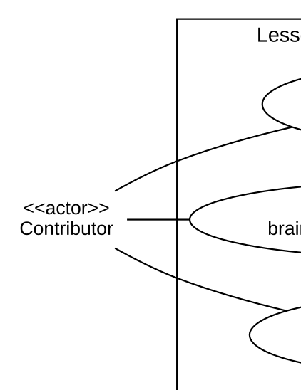
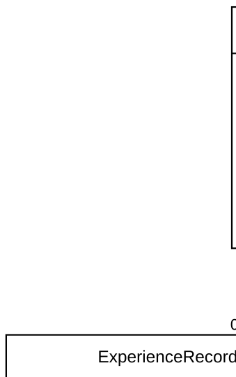
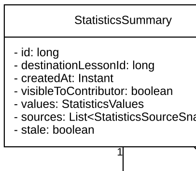
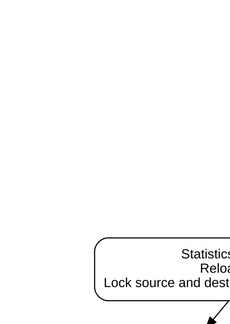
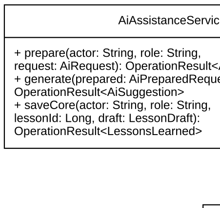

# Detailed Design

CSE 360 Team Project Phase 3. This outline describes implemented class contracts, use cases, collaborators and persistence order. It replaces earlier proposed names where implementation differs. AI API transport is implemented; live-provider acceptance remains pending a locally configured credential.

## 1 Use case model

Authentication and current assigned-role authorization are preconditions. Admin operations and inherited Contributor CRUD remain in scope for regression testing. The diagram separates Contributor shared-aggregate reads from Curator statistics preview/save/sharing authority.

## 2 Use case scenarios

### 2.1 Viewer discovery

- Actor: Viewer. Preconditions: signed in with the current Viewer assignment.
- ViewerLessonService.listLessons or searchLessons invokes DiscoveryAccess.authorized, Database.inTransaction and RoleAccessService.requireRole before reading current lessons and saved terms.
- Case-insensitive whitespace-separated words use AND substring matching across title, problem, lesson text and saved terms. Each search starts from fresh storage. Blank input and Show All restore the full collection.
- readLesson reloads the selected positive ID and returns a ViewerLesson core-only projection. Return refreshes the originating query and preserves only the same still-matching ID.
- Alternative: missing, deleted, invalid or unauthorized selection returns corrective feedback. No mutation or foreign raw experience response is exposed.

### 2.2 Curator reviewed core and terms

- Actor: Curator. Read the current lesson, original owner, related experiences/effort values and protection flags.
- refineLesson authorizes, locks the parent, reloads it, validates LessonDraft and writes only core text. ID, owner, locks, terms and other relationships remain.
- saveTerms validates a complete reviewed list, trims/case-normalizes, removes duplicates and replaces it atomically. Any blank entry rejects the whole replacement; an explicit empty list clears all terms.
- Core locks protect Contributor edits; the authorized Curator refinement route remains available. A deleted parent, removed role or SQL failure leaves prior data unchanged.

### 2.3 Curator snapshot and visibility

- Actor: Curator. Select a destination and at least two distinct experience attempts, optionally spanning lessons. Show source IDs, elapsed minutes and member effort person-minutes before calculation.
- StatisticsService.preview reloads accepted inputs under sorted parent locks, validates every source, sums effort per attempt and calls StatisticsCalculator.calculate. Preview writes nothing.
- save accepts StatisticsRequest, reauthorizes/reloads/locks, compares every reviewed fingerprint, recalculates and inserts a hidden summary plus all source inputs in one transaction.
- Changed or missing sources reject save and require renewed preview. Saved historical values never silently change. Source edits/deletion produce a staleness notice to the Curator.
- setVisibility changes only the sharing flag. Contributor sharedSummaries checks current Contributor role and destination ownership, then returns only shared aggregate projections and units.

### 2.4 AI assistance and reviewed persistence

- Actor: Contributor for WRITE, BRAINSTORM, EXAMPLES; Curator for REFINE and TERMS. Curator tasks require an existing selected lesson; a new Contributor draft may have a null lesson ID.
- AiAssistanceService.prepare checks role, ownership/existence, selected purpose and bounded draft/prompt/history on the application thread. AiPreparedRequest is an immutable accepted snapshot.
- ControllerAiAssistance creates JavaFX Task; ModelAiAssistance.generate calls service.generate and AiClient.generate without JDBC. OpenAiClient sends bounded HTTPS Responses requests.
- The FX success handler reauthorizes before showing a labeled unsaved candidate. Follow-ups include successful prior user/assistant turns. Actual provider URL annotations are shown separately from generated text.
- Accept copies a candidate into editable draft controls only. Save Reviewed Draft delegates to existing create/update/refine rules; Save Reviewed Terms delegates to the atomic Curator term path.
- Cancel invalidates callbacks and interrupts network work. Failure preserves drafts. Missing credentials produce a configuration error, never simulated success.

### 2.5 Protections and rejected operations

- Curator setLessonLocks persists four independent flags: whole lesson, title, problem and lesson text. Unlocking the whole record does not clear selected field or experience protections.
- Contributor core writes require ownership and reject a changed protected field. Unchanged protected values permit otherwise valid unlocked-field edits.
- Whole lesson protection rejects Contributor core edit, deletion and experience create/update/delete. Existing ExperienceLockPolicy continues to protect specific experience fields and deletion.
- Rejected inputs and permissions leave counts, values and relationships unchanged. Parent-row locks coordinate decisions with persistent saves from another connection.

## 3 CRC responsibilities

| Class or MVC family | Responsibilities | Collaborators |
| --- | --- | --- |
| guiViewerLessons MVC | Full/search subset, current read-only core, stable-ID return | ViewerLessonService, ViewerLesson |
| guiCuratorLessons MVC | Cross-owner review, manual reviewed core/terms, protections | CuratorLessonService, existing entities |
| guiCuratorStatistics MVC | Evidence selection, preview, explicit save/history/share/hide | StatisticsService, preview/request/summary types |
| guiContributorStatistics MVC | Owned shared aggregate display and refresh | StatisticsService, SharedStatistics |
| guiAiAssistance MVC | Draft/request/candidate separation, worker task, follow-ups, cancel and reviewed save | AiAssistanceService, AiRequest, AiSuggestion |
| RoleAccessService | Current assignment, single-role dispatch decisions, non-mutating user lookup | Database, RoleNames, User |
| StatisticsService and Calculator | Validate/lock/reload/save snapshots; pure aggregate calculation | Database, immutable statistics types |
| AiAssistanceService and AiClient | Authorize permitted context; generate without JDBC; reviewed saves | LessonService, CuratorLessonService, OpenAiClient |
| Database | Existing storage plus additive terms/statistics, composable transactions and parent locks | H2, java.sql, entities |

## 4 Core domain class model

Every experience has one parent lesson. A valid saved attempt has at least one validated member effort; corrupt or empty effort collections are rejected for statistics. SearchTerm uses a normalized parent/text pair. User role representation retains legacy Contributor/Viewer columns and an independent Curator flag.

## 5 Statistics class model and invariants

- StatisticsPreview holds destinationLessonId, StatisticsValues and immutable accepted sources. toRequest returns destination, distinct source IDs and every reviewed fingerprint.
- StatisticsRequest holds destinationLessonId long, sourceExperienceIds List of Long and reviewedFingerprints Map of Long to String, defensively copied. Invalid/missing mappings are rejected before save.
- Saved summaries have at least two distinct source snapshots. Source uniqueness is (summaryId, originalExperienceId). The same source may support several summaries.
- Original source IDs remain historical values. liveExperienceId is a nullable Long with ON DELETE SET NULL. Destination and summary-child relationships cascade on deletion.
- SharedStatistics excludes provenance and foreign raw records. It contains only id, createdAt and StatisticsValues.

### 5.1 Calculation algorithm

- Reject missing, duplicate snapshot inputs, negative/non-finite elapsed or effort, invalid relationships and invalid effort collections. Duplicate IDs in the user selection count once before capture.
- Sum member effort per attempt using decimal accumulation. Reject an unrepresentable attempt total. Compute count, sorted minimum/maximum, decimal mean, and odd/even median separately for elapsed and effort.
- Preserve full double values. Decimal accumulation avoids intermediate double-sum overflow; even medians use a safe decimal midpoint.
- Fingerprint parent ID, experience ID, elapsed double and ordered member names/effort doubles with length prefixes and SHA-256. A changed name/order is detected even if an aggregate total happens to match.

### 5.2 Snapshot save activity and call order

The GUI call order is ControllerCuratorStatistics.save, ModelCuratorStatistics.save, StatisticsService.save, DiscoveryAccess.authorized, Database.inTransaction, RoleAccessService.requireRole, private prepare/capture, StatisticsCalculator.calculate, Database.insertStatisticsSummary and each insertStatisticsSource. The root transaction commits once; an unsuccessful result or exception rolls back all writes. A stale preview is an error requiring a new review, not an automatic replacement save.

## 6 AI class model and contract

- AiPurpose contains WRITE, BRAINSTORM, EXAMPLES, REFINE and TERMS. AiTurn holds role and text. AiSource holds title and URL; only provider citation annotations populate retrieved-source links.
- AiPreparedRequest is constructed by the service after permission checks. No background generation method uses shared JDBC.
- The production constructor reads OPENAI_API_KEY and optional OPENAI_MODEL. Structured tasks request JSON-schema advice/core/terms. EXAMPLES requests required web_search and decodes actual URL annotations.
- The bounded JSON codec handles escaping, malformed syntax, Unicode and nesting. Complete-body receipt is capped at 256 KiB, output text at 16000 characters, and a request at 45 seconds.
- Prompt, context and history limits are application limits documented in TP3_AI.md. In-memory history is not a database persistence requirement.

## 7 Selected public service contracts

| Service | Actual method | Successful value |
| --- | --- | --- |
| ViewerLessonService | listLessons(String actor); searchLessons(String actor, String query) | OperationResult of List of ViewerLesson |
| ViewerLessonService | readLesson(String actor, String lessonId) | OperationResult of ViewerLesson |
| CuratorLessonService | readLesson; readExperiences; readTerms with actor and String lessonId | Current core, related experience list or saved term list |
| CuratorLessonService | refineLesson(String actor, String lessonId, LessonDraft draft) | OperationResult of LessonsLearned |
| CuratorLessonService | saveTerms(String actor, String lessonId, List of String proposed) | OperationResult of List of SearchTerm |
| CuratorLessonService | setLessonLocks(String actor, String lessonId, LessonLockState locks) | OperationResult of LessonsLearned |
| StatisticsService | preview(String actor, String destination, List of Long sourceIds) | OperationResult of StatisticsPreview |
| StatisticsService | save(String actor, StatisticsRequest request) | OperationResult of StatisticsSummary |
| StatisticsService | listSummaries(String actor, String destination); readSummary(String actor, String summaryId) | Saved summaries or selected summary |
| StatisticsService | setVisibility(String actor, String summaryId, boolean visible) | OperationResult of StatisticsSummary |
| StatisticsService | sharedSummaries(String actor, String destination) | OperationResult of List of SharedStatistics |
| AiAssistanceService | prepare(String actor, String role, AiRequest request); generate(AiPreparedRequest prepared) | Prepared request or unsaved suggestion |
| AiAssistanceService | saveCore(String actor, String role, Long lessonId, LessonDraft draft) | OperationResult of LessonsLearned |
| AiAssistanceService | saveTerms(String actor, Long lessonId, List of String terms) | OperationResult of List of SearchTerm |

Database helpers are trusted storage interfaces. Authorization is enforced at public business service boundaries. New reads use immutable returned lists; GUI full/subset collections are refreshed after accepted changes and never silently select a different missing record.

## 8 Verification and open evidence

- TP3FinalIntegrationTest combines Contributor CRUD, AI HTTP fixture review, Curator terms/locks, Viewer discovery, statistics visibility, restart and cascade behavior in one workflow.
- Feature JUnit classes cover all new major service methods; readable inherited suites retain TP1/TP2/HW3 regression checks. GUI automation exercises actual controls, and TP3ModularSmoke exercises named-module startup.
- Live AI acceptance, native Eclipse rendering and team process evidence remain separate unclaimed checks. See Manual Tests.pdf and the Integration Report.
